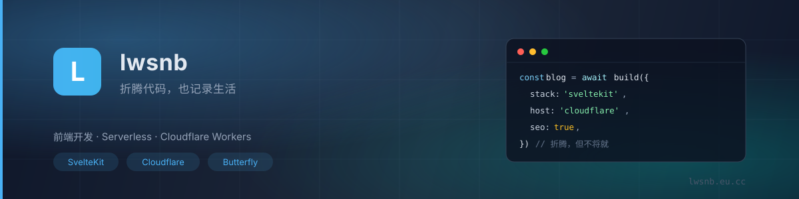

 

**折腾代码，也记录生活**

前端开发 · Serverless · Cloudflare Workers 自托管博客与在线工具

---

### 关于我

- 一个普通人的技术博客，记录折腾过程与踩过的坑
- 主要折腾 **Cloudflare Workers / Pages**、**SvelteKit**、**Valaxy**
- 喜欢把静态站改造成动态站，再用静态预渲染把 SEO 补回来
- 所有服务尽量跑在免费额度内，能自托管就不买

### 技术栈

### 数据

### 精选项目

<table>
<tr>
<td width="50%" valign="top">

**[blog](https://github.com/lws666/blog)**
我的博客源码。Valaxy + Cloudflare Worker + D1 + B2 的动态博客，
外加 SvelteKit 全量预渲染版本。

`JavaScript` `SvelteKit` `Cloudflare`

</td>
<td width="50%" valign="top">

**[meting-api](https://github.com/lws666/meting-api)**
自建的 Meting 音乐 API，给博客的 APlayer 供曲。

`JavaScript` `Cloudflare Workers`

</td>
</tr>
<tr>
<td width="50%" valign="top">

**[one-ip](https://github.com/lws666/one-ip)**
单 IP 优选服务，自用小工具。

`Cloudflare Workers`

</td>
<td width="50%" valign="top">

**[cfnb](https://github.com/lws666/cfnb)**
Cloudflare 相关脚本合集。

`Python`

</td>
</tr>
</table>

---

Powered by SvelteKit · Cloudflare · 自制主题

